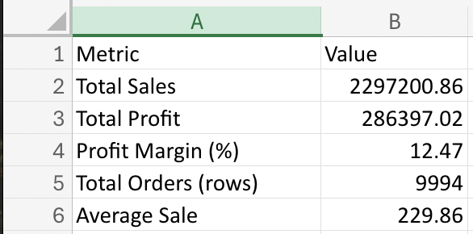
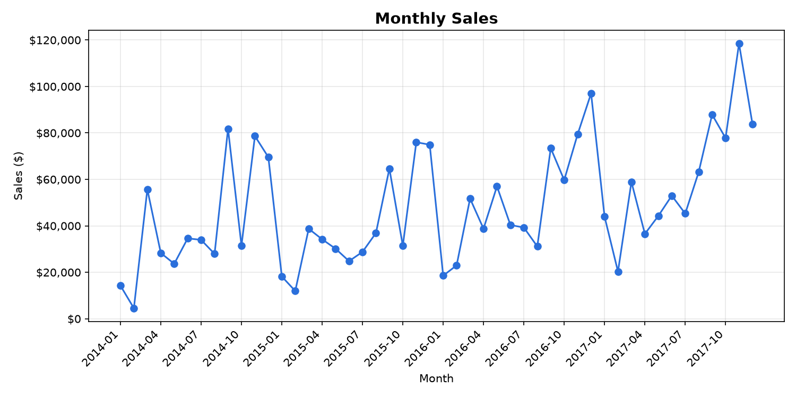

# Automated Sales Report Generator

A Python script that takes a raw sales CSV, cleans it, and automatically generates an Excel summary report and a monthly sales chart. What would take manual spreadsheet work now takes one command.

## What it does
- Cleans the data: removes duplicates, fixes dates and numbers, and handles blank values
- Calculates total sales, total profit, and profit margin
- Summarizes sales and profit by category
- Finds the top 5 products by sales
- Shows monthly sales with month-over-month % change
- Saves everything to an Excel file (one sheet per summary) plus a PNG chart

## Results
Run on a sample retail dataset of 9,994 sales records:
- **Total sales:** $2,297,200.86
- **Total profit:** $286,397.02
- **Profit margin:** 12.47%




## How to run
1. Install the libraries:
   ```
   pip install pandas openpyxl matplotlib
   ```
2. Download the dataset from Kaggle (link below) and save it in the same folder as the script.
3. Run:
   ```
   python report_generator.py "Sample - Superstore.csv" sales_report.xlsx
   ```
4. Open `sales_report.xlsx` and the chart image `sales_report_monthly_sales.png`.

## Using your own data
The script works with any sales CSV that has these columns: `Order Date`, `Category`, `Sub-Category`, `Product Name`, `Sales`, `Quantity`, `Discount`, `Profit`.

## Tools used
Python, pandas, openpyxl, matplotlib

## Dataset
Sample Superstore data (a standard practice dataset, not current business data):
https://www.kaggle.com/datasets/vivek468/superstore-dataset-final
